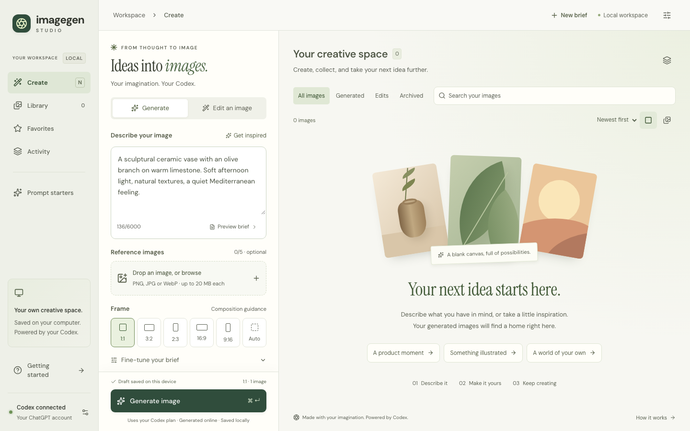
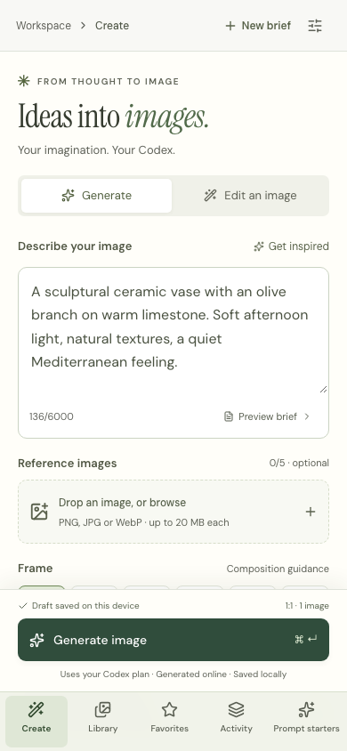

# Imagegen Studio

**A local creative workspace for your Codex imagegen skill.** Turn a brief into an
image, refine it with references, and keep every iteration in your own library.

[](https://github.com/pate0304/imagegen-studio/actions/workflows/ci.yml)
[](LICENSE)



<details>
<summary>Mobile workspace</summary>



</details>

Uses your **installed Codex app server and existing ChatGPT login**. No separate
API key, credential copying, or hidden generation service. Independent community
project; not affiliated with or endorsed by OpenAI.

## What you can do

- **Create and edit:** clear briefs, seven prompt starters, style direction, exact
  text, preservation constraints, framing and transparent-background requests.
- **Work with references:** drop, paste or upload up to five images; assign an
  edit target or style reference. Inspect original and edited results together.
- **Stay in flow:** persistent unfinished drafts, an always-visible Generate
  action, keyboard shortcuts, undo for new briefs, starters and archiving.
- **Keep a library:** search, sort, compact/comfortable grids, favorites, original
  downloads, reusable briefs and JSON prompt exports.
- **Control generation:** 1–4 serial variations, live activity, cancellation and
  explicit pause/resume. Failures pause the queue; there are no automatic retries.

The interface and library run locally. **Image generation runs online** through
Codex and uses your account's limits. Prompts and selected references go to the
provider. The web app has no telemetry, external fonts or frontend CDNs.

## Get started

You need:

1. **Node.js 22.12+** and npm. Node 22 or 24 LTS is recommended.
2. A **Codex installation with app-server image generation**, signed in with
   ChatGPT. Install/login using the [official Codex CLI guide](https://learn.chatgpt.com/docs/codex/cli).
   Not every CLI build or account exposes the image tool.
3. The **imagegen skill installed in Codex**. By default Studio reads
   `~/.codex/skills/.system/imagegen/SKILL.md`. For another installation, set
   `IMAGEGEN_SKILL` to that skill's full `SKILL.md` path. The skill is not bundled
   or downloaded by Studio; an API-only imagegen script is not a substitute for
   a runtime with the built-in image tool.

```sh
git clone https://github.com/pate0304/imagegen-studio.git
cd imagegen-studio
npm ci
npm run build
npm run doctor
npm start
```

Open **[127.0.0.1:4310](http://127.0.0.1:4310)**. Stop the server with Ctrl+C.
`doctor` checks your connection without generating an image or changing Codex
settings. If it fails, follow its message or open **Connection settings** in the
studio. You can still start the UI to inspect setup guidance.

On macOS, after cloning you can also double-click **Start Imagegen Studio.command**.
It installs dependencies/builds if needed, starts the server, and opens your
browser. Keep its terminal open while creating. Closing the browser does not
stop queued work.

**Compatibility:** live generation and transparent edits were verified on macOS
arm64 with Codex `0.158.0-alpha.2`. Automated fixtures cover Linux/macOS through CI;
that does not certify live Codex support on every OS/version. Windows is unverified.
See the [verification record](docs/VERIFICATION.md).

## Your first image

1. Write a brief or select a **Prompt starter**. Set the framing; expand
   **Fine-tune your brief** for style, exact text and preservation constraints.
2. Optionally add references. In **Edit an image**, choose exactly one **Edit target**.
3. Generate. Each variation is a separate generation using your Codex limits.
4. Open a result to download its original, compare an edit with its source,
   favorite it, reuse the brief or start another edit. Archive is reversible.

`⌘/Ctrl + Enter` submits the composer. `N` focuses it outside text inputs and
modals. Escape closes a dialog and returns focus. **New brief** resets the form
with Undo. Unfinished drafts are saved in the current browser, including drafts
that are not yet valid for generation.

Aspect ratio, exact text and edit preservation are instructions to the model,
not pixel-level guarantees. Actual output dimensions and alpha-channel metadata
appear on each result. Template covers are abstract illustrations, not generated
samples.

## Configuration and local data

The app inherits your Codex model/provider. It enables `image_generation` only
for its child process and makes no global config writes. It requires the
ChatGPT/OpenAI authentication path and never silently switches to API billing.
It checks known desktop installations and PATH, choosing the newest available
binary. Override that choice with `CODEX_BIN` if needed.

| Environment variable | Purpose                                                   |
| -------------------- | --------------------------------------------------------- |
| `PORT`               | Local port; default `4310`                                |
| `CODEX_BIN`          | Explicit Codex executable path                            |
| `CODEX_HOME`         | Existing Codex profile directory; passed through          |
| `IMAGEGEN_SKILL`     | Path to an installed imagegen `SKILL.md`                  |
| `STUDIO_DATA_DIR`    | Private library directory; default `.data` in the project |
| `STUDIO_OPEN=1`      | Open the browser on startup (macOS/Linux)                 |

For example, in a POSIX shell:

```sh
IMAGEGEN_SKILL="$HOME/.codex/skills/imagegen/SKILL.md" npm start
```

`.data` contains SQLite metadata, originals, references, thumbnails and isolated
job directories. **Back up this directory with the server stopped** to retain
your library. Archive hides files without deleting them. Browser drafts live in
localStorage separately. After a restart, interrupted jobs are marked interrupted
and pending jobs wait for Resume. A process lock prevents two servers opening
the same library.

The server binds to `127.0.0.1`, validates Host/Origin and bounded uploads, and
serves database-selected assets. This is a single-user local app. Do not expose
it publicly. Read [SECURITY.md](SECURITY.md) for the trust boundary.

## Development

```sh
npm run dev                      # Vite + Express, port 4310
npm run format                   # Prettier
npm run check                    # Formatting, types, production build, API tests
npx playwright install chromium  # One-time browser install
npm run test:browser              # Desktop/mobile journeys + axe accessibility
```

Tests use isolated synthetic app-server fixtures, never your account or real
library. No Codex login or API key is required to run them. See
[CONTRIBUTING.md](CONTRIBUTING.md) and [architecture](docs/ARCHITECTURE.md).

## Troubleshooting

**Connection needs attention:** run `npm run doctor`. Verify the selected
executable with `codex login status`. If Studio picked another installed binary,
set `CODEX_BIN`. Use **Check connection** after resolving login/skill issues; it
refreshes the cached check immediately.

**Missing imagegen skill or image tool:** install/update Codex through its normal
distribution and locate its installed imagegen skill. If your build lacks the
built-in tool, Studio cannot enable it by supplying a prompt. There is no API-key
fallback. You can open the UI without generation access.

**Job failed or queue paused:** inspect **Activity**, correct the issue and reuse
the brief. Resume pending jobs only when ready. Each manual retry consumes normal
Codex usage if it generates an image.

**Port busy or library already open:** use the existing browser window, stop the
other server, or select a different `PORT` and `STUDIO_DATA_DIR`.

**After updating:** stop the server, run `npm ci && npm run build`, then restart.
Back up `.data` first. Codex app-server is evolving; check compatibility when
updating the runtime. Native SQLite/Sharp install failures may require the build
tools documented by those dependencies.

## Open-source foundation

React, Vite and TypeScript; Express, Zod and Multer; better-sqlite3/SQLite; Sharp;
TanStack Query; Radix Dialog; Lucide; Sonner; json-rpc-2.0; proper-lockfile;
self-hosted Fontsource fonts. Node's test runner, Supertest, Playwright and
axe-core provide verification. Exact dependency versions are locked.

The adapter uses [Codex app server](https://learn.chatgpt.com/docs/app-server)
over local stdio with an explicit skill input and local reference images. It
requires successful image-generation events before importing real output.
Read [architecture](docs/ARCHITECTURE.md) for protocol and queue details.

[MIT licensed](LICENSE). Dependencies and the separately installed Codex skill
retain their own licenses. Contributions and reproducible bug reports are welcome.
